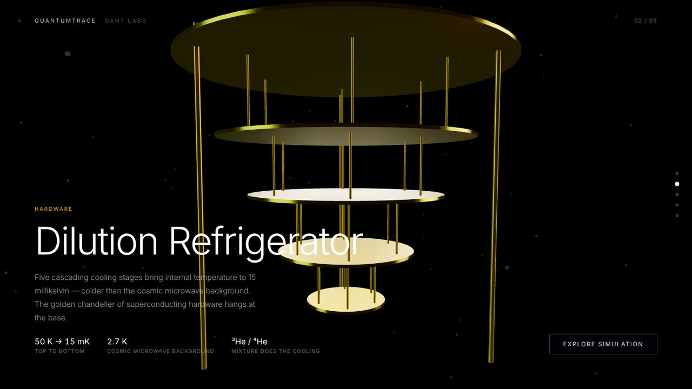
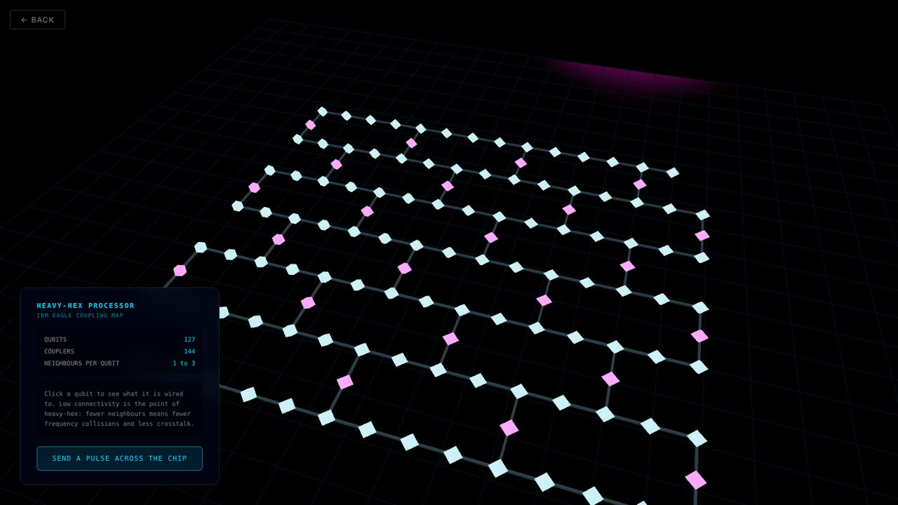
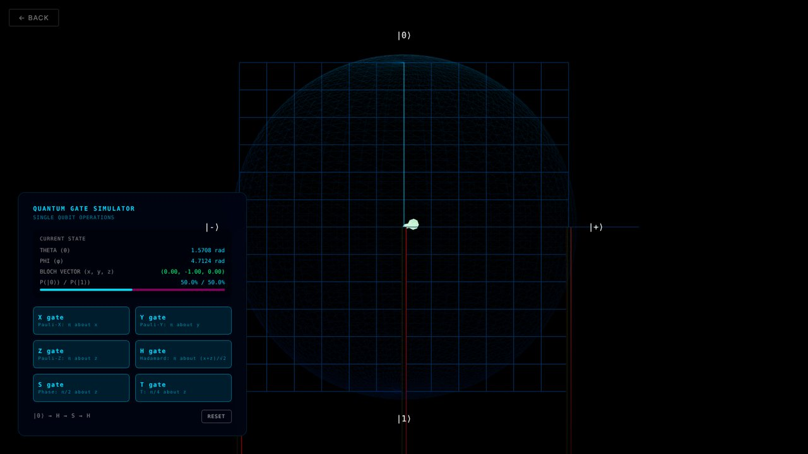
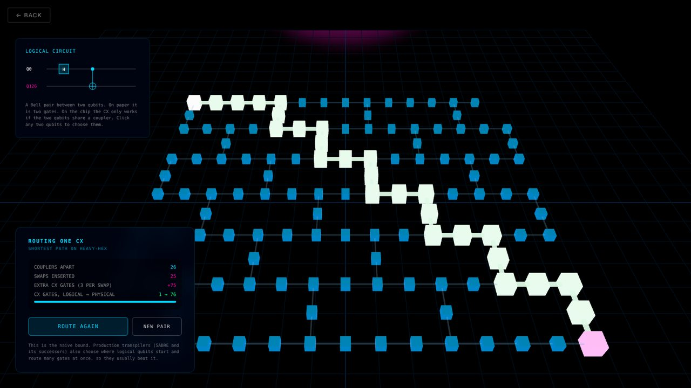
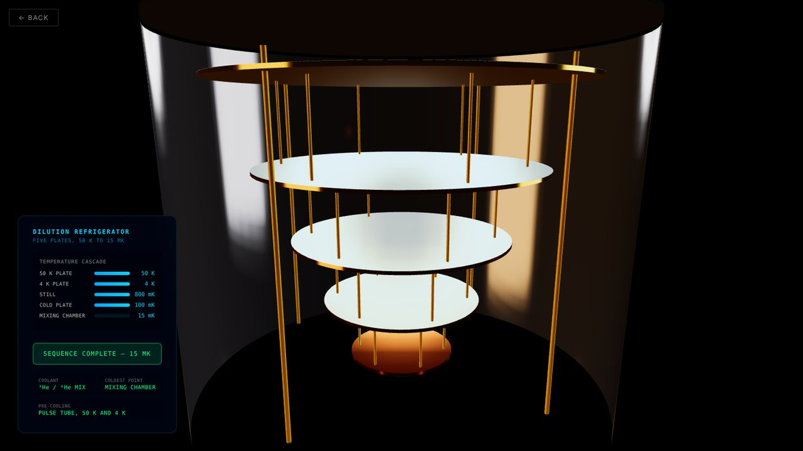
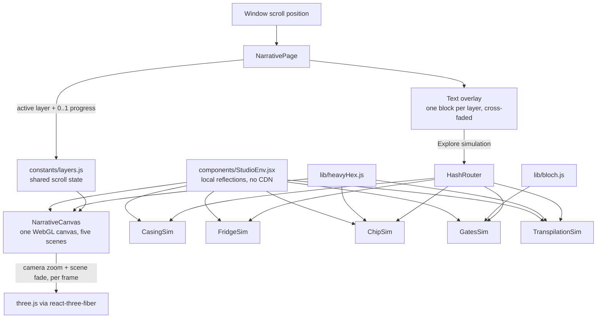

# QuantumTrace

**Scroll from the outside of a superconducting quantum computer down to its chip, then into the software that runs on it.** Five layers, each with an interactive 3D simulation behind it. Built for Qant Labs.

**[Live demo](https://prometheus5863.github.io/prometheus5863/quantumtrace/)**



## What's in it

| Layer | What you see on the way down | The simulation behind it |
|---|---|---|
| Outer casing | The aluminium housing | Slide the thermal shielding away and watch a model chip temperature climb from 15 mK toward room temperature |
| Dilution refrigerator | The gold "chandelier" | Run the cool-down through the five plates: 50 K, 4 K, still, cold plate, mixing chamber |
| 127-qubit processor | IBM's Eagle heavy-hex lattice | The real coupling map: 127 qubits, 144 couplers. Click any qubit to see what it is wired to |
| Control and gates | A qubit state on the Bloch sphere | Apply X, Y, Z, H, S and T and watch the Bloch vector rotate, with measurement probabilities |
| Circuit transpilation | A gate being routed across a chip | Pick two qubits, route a CX between them, and see how many SWAPs the detour costs |

| | |
|---|---|
|  |  |
|  |  |

## What is real and what is illustrative

This is a teaching visual, not a device simulator, so it is worth being exact about which parts are which.

**Real**
- **The chip layout.** `src/lib/heavyHex.js` generates the Eagle heavy-hex coupling map: seven rows of qubits joined by four bridge qubits between each pair of rows. It comes out at 127 qubits and 144 couplers, numbered the way IBM numbers them.
- **The gates.** `src/lib/bloch.js` applies each gate as an exact rotation of the Bloch vector. `H`, `S`, `H` from |0⟩ lands on −y, as it should.
- **The routing arithmetic.** The transpilation page runs a breadth-first shortest path on the coupling map. A CX between qubits *d* couplers apart needs *d* − 1 SWAPs, and each SWAP is three CX gates.
- **The refrigerator stages.** Plate names and temperatures are typical values for a dilution refrigerator.

**Illustrative**
- **The casing temperature.** A log-scale interpolation between 15 mK and 300 K, to show the idea of shielding. It is not a thermal model.
- **The routing strategy.** Shortest-path-then-SWAP is the naive bound. Real transpilers (SABRE and later) also choose the initial layout and route many gates together, and usually do better.
- **The 3D models.** Shapes are stylised, not to scale.

## How it works



- **One scroll track.** The page is an empty column one viewport tall per layer. A single scroll handler works out which layer is active and how far through it you are, and writes that to a small shared store. Nothing is pinned, so two layers can never overlap on screen.
- **One canvas for the narrative.** All five scenes live in the same WebGL canvas. Each frame, the active scene fades in, the others fade out, and the camera moves between a "rest" and an "end" pose for that layer. The blending is time-based, so it behaves the same at 30 fps and 144 fps.
- **No runtime network requests.** Reflections come from light panels built in code (`StudioEnv`), not from an HDRI fetched from a CDN, and labels are plain HTML. The built site works offline and from any sub-path.

## Run it

Needs Node 18 or newer.

```bash
npm install
npm run dev        # http://localhost:3000
npm run build      # static site in dist/
npm run preview    # serve the build locally
npm run lint
```

The build uses relative asset paths and hash-based routes, so `dist/` can be dropped onto any static host. `.github/workflows/pages.yml` builds and deploys it to GitHub Pages on every push to `main` (set **Settings → Pages → Source** to **GitHub Actions** once).

## Project layout

```
src/
  pages/NarrativePage.jsx     scroll handler and text overlay
  pages/sim/*.jsx             the five simulations
  components/NarrativeCanvas.jsx   the five narrative scenes and the camera
  components/StudioEnv.jsx    local environment lighting
  constants/layers.js         copy, facts and shared scroll state for each layer
  lib/heavyHex.js             Eagle coupling map, shortest path, routing cost
  lib/bloch.js                single-qubit gates as Bloch-vector rotations
```

## Stack

React 19, three.js, react-three-fiber, drei, React Router, Vite.
